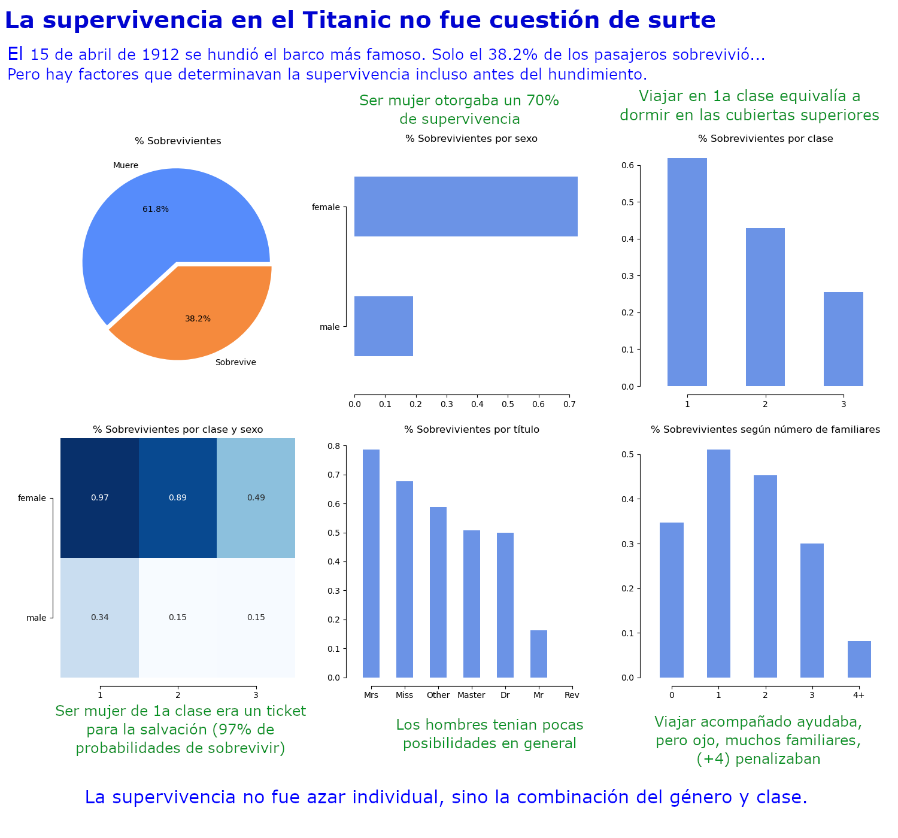
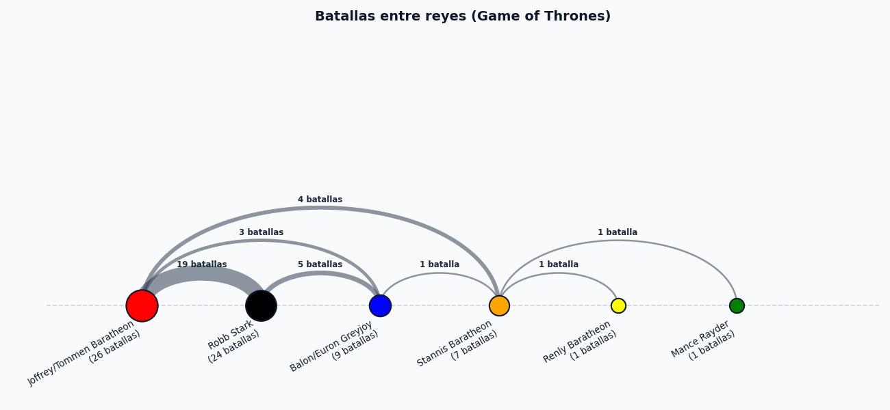
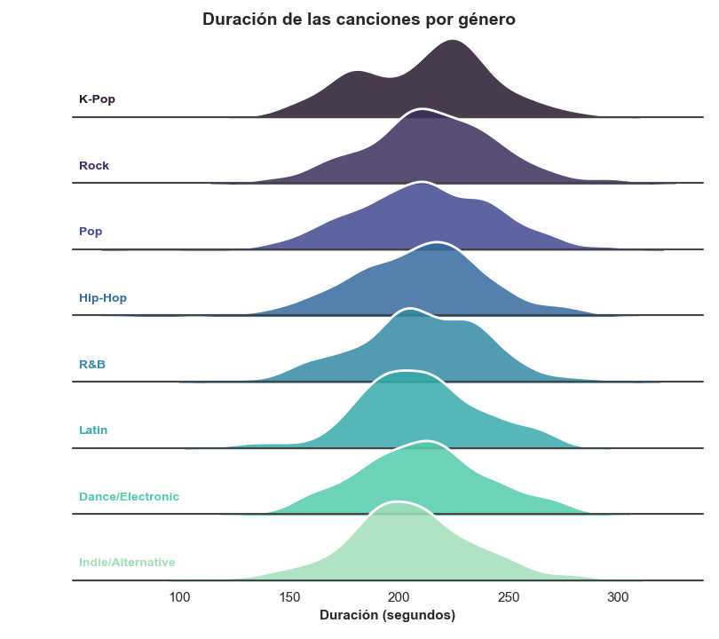

# PEC 2: Estudio de técnicas de visualización de datos
## M2.859 - Visualización de datos - Aula 4
### Universitat Oberta de Catalunya (UOC)

> #### Alumno: Eloy Mor Polo (curso 2026/2027)

---

## 1. Infografía — Supervivencia de los pasajeros del Titanic

> **Conjunto de datos utilizado:** [Titanic Dataset (Frank E Harrell Jr PhD)](https://hbiostat.org/data/repo/titanic3.csv)

**Origen:**

La infografía tiene su origen en el siglo XVIII, cuando los periódicos empezaron a ilustrar algunas informaciones 
publicadas. El **mapa de John Snow (1854)** se considera el inicio de la infografía moderna porque utilizaba métodos 
geográficos para describir y localizar los casos de una epidemia. 
Se consolidó como género de visualización de datos por el *USA Today*, la aparición de los ordenadores con programas
de edición de gráficos. 
Actualmente se ha extendido del periodismo hacia los ámbitos empresariales, científicos y académicos.

**Clasificación:**
- *Según finalidad*: **periodística o informativa**.
- *Según composición*: **estadística** (con algunos rasgos de **comparativa**).
- *Tipo de visualización*: **estática** (comunicar unos datos previamente analizados y ayudar 
a descubrir patrones y valores atípicos)

**Tipos de datos:**
- **Cualitativos categóricos**: sexo y título nobiliario.
- **Cualitativos ordinales**: clase del billete (1.ª / 2.ª / 3.ª).
- **Cuantitativos discretos**: número de supervivientes y de familiares.

**Ventajas:**
- **Permite filtrar el ruido**
- **Mejora de la comprensión**
- **Promueve compartir**
- **Se recuerdan más**

**Limitaciones:**
- El **exceso de información** puede perjudicar la comprensión y la memorización.
- **Riesgo de que la estética se imponga a la funcionalidad**.
- **Cuidado con escalas no proporcionales**.
- **Posible saturación de elementos**.

---

## 2. Arc diagram (diagrama de arco) — Batallas de *Juego de Tronos* entre reinos

> **Conjunto de datos utilizado:** [Game-of-Thrones-Dataset - Battles (TheMLGuy)](https://github.com/TheMLGuy/Game-of-Thrones-Dataset)

**Origen:**
Ámbito de la **visualización de redes o grafos**, utiliza técnicas visuales e interactivas para facilitar
la exploración, el filtrado y la comprensión de datos estructurados en forma de red. Es una 
**variante del modelo nodo-enlace** (*node-link layout*): los nodos se disponen en una **línea horizontal** (eje x)
y las relaciones se dibujan con **arcos semicirculares** entre ellos.
El gráfico realizado es además otra variación del arc diagram: **weighted network**

**Clasificación:**
- *Tipo de visualización por estructura de datos*: **visualización de red** (*nodo-enlace*)
- *Tipo de visualización*: **estática**.
- *Naturaleza del grafo construido*: **no dirigido** (cada batalla es un enlace simple entre dos reinos). **Ponderado**,
el grossor del arco marca el número de enfrentamientos entre dos reinos.

**Tipos de datos:**
- **Nodos**: reinos o reyes, datos **cualitativos categóricos**.
- **Aristas**: batallas, son de tipo **cuantitativo discreto**.

**Ventajas:**
- **Hace visibles las relaciones**, que podrían no ser intuitivas en una tabla.
- **Ocupa menos espacio**: porque sitúa todos los nodos sobre una única línea.
- **Adecuado para redes pequeñas y medianas**, que tengan una densidad promedio de 3 a 4 enlaces por nodo.

**Limitaciones:**
- **Escalabilidad**: Visualización no apta para redes masivas (saturación visual).
- **Saturación en la línea de nodos**.
- **Precisión comparativa**: al codificar las relaciones con curvas y no con longitudes rectas, 
no es lo hace un gráfico adecuado para comparar cantidades de forma precisa.
- **No es interactivo**,

---

## 3. Ridgeline plot (joy plot) — Duración de las canciones más escuchadas en *Spotify* (2018-2026) por género musical

> **Conjunto de datos utilizado:** [Global Spotify Hits & Audio Dynamics (2018–2026)](https://www.kaggle.com/datasets/vedauv/global-spotify-hits-and-audio-dynamics-20182026/)

**Origen:**
- Procede de la familia de representaciones **estadísticas descriptivas de distribuciones**.
- Se utiliza para visualizar conjuntos de datos con varias variables numéricas no ordinales.
- Sirve para comparar varias distribuciones.
- Mejora del **boxplot** o del **violin plot** para muchos grupos.

  
**Clasificación.**
- *Según los criterios estadísticos y tipología*: **descriptiva**, se utiliza para describir de forma gráfica 
los atributos que determinan una población a partir del conjunto de datos disponible.
- *Según la relación entre datos y objetivo*: **distribuciones** y **comparaciones**.
- *Tipo de visualización*: **estática**.

**Tipos de datos.**
- Variable analizada: **cuantitativa continua**, duración de la canción (en segundos).
- Variable de agrupación: **categórica**, género musical.

**Ventajas.**
- **Comparación simultánea de muchas distribuciones**: Tiene un eje (X) compartido (la duración en segundos), 
permite contrastar de un vistazo la forma de la distribución de cada género, ocupando mucho menos espacio que varios 
histogramas independientes.
- **Muestra la forma completa de la distribución**: simetría o asimetría, bimodalidad, colas y valores atípicos.

**Limitaciones.**
- **Solapamiento entre crestas**: la superposición de las distribuciones puede obligar a ordenarlas, las densidades se 
pueden leer de forma incorrecta.
- **Percepción de áreas y densidades**: Al ojo humano le cuesta comparar áreas con precisión, pero no longitudes y 
distancias.
- **Lectura de valores exactos**: no sería un gráfico adecuado para obtener cifras concretas ni para comparaciones precisas
entre géneros.
- **Sensibilidad al tamaño de muestra**: si hay pocas canciones por género, la densidad estimada puede ser ruido y la cresta 
deja de ser significativa.
- **Riesgo de *chartjunk***: el relleno y la superposición pueden aumentar la tinta sin aportar información, contra el 
principio del **ratio datos/tinta** de Tufte.

---

## Resumen comparativo

| Visualización | Origen | Clasificación principal | Tipos de datos | Ventaja clave | Limitación clave |
|---|---|---|---|---|---|
| **Infografía** (Titanic) | Prensa s. XVIII; Minard y John Snow (1854); *USA Today* y Guerra del Golfo | Periodística-informativa, estadística/comparativa, estática | Mezcla de categóricos, ordinales, cuantitativos (discretos) y narrativos | Recuerdo, comprensión y capacidad de síntesis | Estética sobre funcionalidad, estática y no explorable |
| **Arc diagram** (GoT) | Visualización de redes, teoría de grafos, variante nodo-enlace | Visualización de red,  conexiones, estática | Nodos categóricos + aristas ponderadas (cuantitativo discreto) + metadatos | Hace visibles las relaciones | Saturación y cruce de arcos al crecer la red |
| **Ridgeline plot** (Spotify) | Familia descriptiva de distribuciones (boxplot / violin plot) | Descriptiva, comparación de distribuciones, estática | Cuantitativo continuo agrupado por categórico, datos agregados | Compara muchas distribuciones en poco espacio | Solapamiento, mala lectura de valores y de áreas |

---

